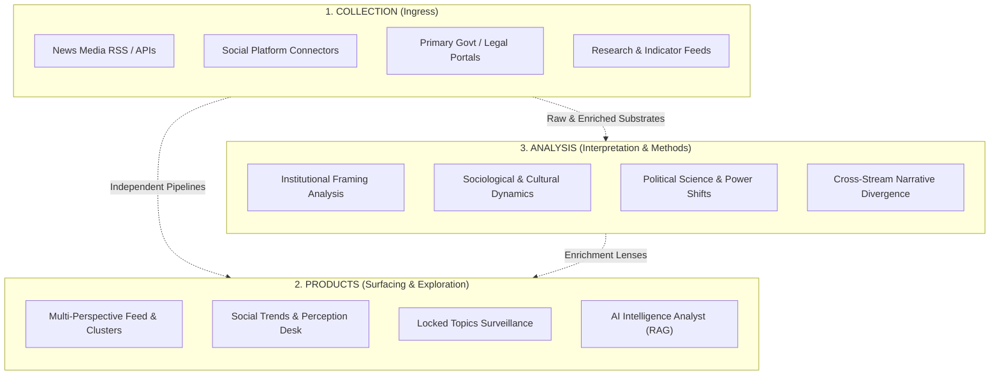

# Informnt: Architectural Philosophy, Identity & Scope

> **Tagline:** *Understand the world as it unfolds.*  
> **Core Inquiry:** *What is happening in the world right now? Why does it matter, how does it connect, and how do different perspectives interpret it?*  
> **Status:** Canonical Architecture & Philosophy Document  
> **Last Updated:** 2026-10-25  

---

## 1. What is Informnt? Core Identity & Purpose

### The Simple Explanation
Informnt helps you keep up with what is happening in the world without having to navigate dozens of news websites or drown in fragmented headlines. It gathers reporting from diverse international and regional publishers, structures related developments into coherent timelines, and helps you see the bigger picture rather than an isolated stream of dispatches.

### The Deeper Vision
Informnt is an evolving intelligence and monitoring platform designed to cultivate a continuously updated, empirical understanding of global reality. It begins with news media—aggregating reporting across different countries, publishers, and ideological perspectives to detect developing events, trace causality, and surface structural dynamics.

Over time, Informnt expands into independent modules for social-media discourse, public narratives, primary government records, and economic/scientific datasets. Specialized analytical modules then draw on these multi-stream datasets to interpret events through **sociology, political science, economics, and empirical frameworks**.

The ultimate objective is not merely telling people what happened. It is empowering them to understand **what is happening, how it fits into the wider world, and what it might mean**.

### What Informnt IS vs. What Informnt IS NOT

```
┌─────────────────────────────────────────┬───────────────────────────────────────────┐
│ WHAT INFORMNT IS                        │ WHAT INFORMNT IS NOT                      │
├─────────────────────────────────────────┼───────────────────────────────────────────┤
│ • An intelligence & monitoring platform │ • A generic RSS reader or article firehose│
│ • A multi-perspective framing engine    │ • A single-shot AI summarizer (summary is │
│ • An empirical analytical workbench     │   a mechanism, not the destination)       │
│ • An evidentiary hierarchy of signals   │ • A monolithic crawler attempting to ingest│
│ • A structured timeline & dossier system│   the entire internet into one giant pipe │
└─────────────────────────────────────────┴───────────────────────────────────────────┘
```

Informnt is neither a basic news aggregator nor an AI wrapper that simply condenses articles. Aggregation and LLM synthesis are instrumental capabilities; the true product is **structured comprehension and cognitive clarity**.

---

## 2. Architectural Separation of Concerns: The Three-Layer Rule

To maintain long-term scalability and prevent architectural debt, Informnt strictly isolates three fundamental layers of the system:



1. **Collection (Ingress)**:
   - *Where and how information enters the system.*
   - Implemented as modular, decoupled ingress adapters (RSS streams, custom scrapers, social API connectors, official document monitors).
   - Ingress adapters run on isolated worker schedules and **never** assume uniform data structures or equal evidentiary reliability.
2. **Products (Surfacing & Exploration)**:
   - *How users explore and interact with information.*
   - Features (e.g., the 3-Axis News Feed, Story Clusters, Social Perception Desk, Locked Topics Surveillance, Analyst Chat) are self-contained and independently valuable.
   - A user can read curated news without engaging with social trends, or examine social reactions without reading 20 long-form articles.
3. **Analysis (Methods & Empirical Interpretation)**:
   - *The academic methods and analytical frameworks used to extract meaning.*
   - Operates downstream from collection. Analyzes datasets using rigorous models (sociology, political science, economics, media framing studies) rather than generic, unstructured LLM prompt summaries.
   - Powers optional cross-layer synthesis (e.g., measuring the divergence between news editorial priority and organic social discourse over time).

This separation guarantees that introducing new sources or academic methodologies never requires refactoring the foundational ingestion engine.

---

## 3. The Three-Tier Modular Product Roadmap

Rather than attempting to build an all-encompassing system upfront, Informnt follows a disciplined, staged trajectory:

```
  Tier 1: News Intelligence  ───►  Tier 2: Social Intelligence  ───►  Tier 3: Analytical Modules
  [Core Product / Present]         [Future Independent Module]        [Future Empirical Capability]
  • Publisher curation             • Platform-specific collection    • Sociology & Political Science
  • RSS ingestion & dedup          • Trending topics & discourse     • Economic & Structural Models
  • 10-category gazetteer lock     • Narrative evolution & reactions • Elite vs. Public Narrative Split
  • Story clustering & dossiers    • Decoupled from news ingress     • Cross-stream divergence metrics
```

### Tier 1: News Intelligence (Core Product — Active Phase)
The foundational backbone of Informnt.
- **Pipeline:** Publisher curation → RSS ingestion → URL/Hash deduplication → Stage 1 deterministic classification → Stage 2 LLM enrichment (entities, bias, sentiment) → vector embeddings → pgvector story clustering → timeline dossiers.
- **Purpose:** Clarify what verified news organizations are reporting globally, map editorial framing divergences, and organize disparate events into cohesive narrative arcs.
- **Current Scope Boundary:** Curate an authoritative, evidence-backed news media portfolio (wire services, regional/local publishers, strategic national outlets, specialist publications). Curate specialist outlets strictly as *news publishers*, without prematurely building custom academic or financial data ingestion pipelines.

### Tier 2: Social Intelligence (Future Independent Module)
An autonomous companion module providing public discourse context.
- **Pipeline:** Platform-specific collectors (Reddit, X, specialized communities) → trend tracking → discussion clustering → narrative summarization → public sentiment tracking.
- **Purpose:** Illuminate what people are discussing, how public sentiment shifts during a crisis, and what counter-narratives or local eyewitness accounts are emerging.
- **Decoupled Independence:** The social module operates as an independent product. It is **not** coupled to the news ingestion pipeline, preventing social media spam or volatility from polluting verified news storage.
- **Epistemological Guardrail:** News coverage is not equivalent to public opinion, and social media commentary is not a representative sample of human populations. The social module provides discourse context with explicit methodological caveats.

### Tier 3: Analytical Modules & Empirical Interpretations (Future Capability)
Specialized microservices and analytical lenses applying academic disciplines to collected data.
- **Disciplines:**
  - **Sociology:** Cultural currents, collective attention cycles, social movements, polarization dynamics, community reaction vectors.
  - **Political Science:** Institutional power shifts, geopolitical alignments, regime stability, propaganda/framing mechanisms, state-aligned discourse tracking.
  - **Economics:** Trade dependencies, supply chain disruption signals, market sentiment contagion, policy impacts.
- **Methodology:** Explicit, empirical analytical methods applied to suitable datasets rather than superficial LLM chat summaries.
- **Cross-Stream Synthesis:** Enabling comparative research, such as:
  - *Agenda Setting vs. Public Response:* Does media coverage drive social attention, or does grassroots viral discourse force media pickup?
  - *Framing Divergence:* How does state-aligned media framing contrast with organic civil discourse on the same geopolitical event?

---

## 4. The 6 Information Signal Archetypes & The Evidentiary Principle

Informnt's conceptual architecture recognizes 6 distinct information signal archetypes:

```
                                      ┌──────────────┐
                                      │   Informnt   │
                                      └──────┬───────┘
                                             │ "What is happening in the world right now?"
                   ┌─────────────────────────┴─────────────────────────┐
                   ▼                                                   ▼
         ┌───────────────────┐                               ┌───────────────────┐
         │ 📰 News media     │                               │ 💬 Social         │
         │ Reporting,        │                               │    platforms      │
         │ investigation,    │                               │ Emerging          │
         │ analysis,         │                               │ narratives, public│
         │ eyewitness.       │                               │ reactions, local. │
         └─────────┬─────────┘                               └─────────┬─────────┘
                   ▼                                                   ▼
         ┌───────────────────┐                               ┌───────────────────┐
         │ 🏛️ Primary         │                               │ 📈 Data and       │
         │    sources        │                               │    research       │
         │ Govt statements,  │                               │ Economic metrics, │
         │ regulations,      │                               │ scientific papers,│
         │ legal filings.    │                               │ official datasets.│
         └─────────┬─────────┘                               └─────────┬─────────┘
                   ▼                                                   ▼
         ┌───────────────────┐                               ┌───────────────────┐
         │ 📡 Specialist     │                               │ 🌐 Other channels │
         │    signals        │                               │ Community orgs,   │
         │ Conflict monitors,│                               │ expert networks,  │
         │ marine trackers,  │                               │ public registries,│
         │ climate alerts.   │                               │ civic databases.  │
         └─────────┬─────────┘                               └─────────┬─────────┘
                   │                                                   │
                   └─────────────────────────┬─────────────────────────┘
                                             ▼
                          Normalize · Verify · Connect · Interpret
                Bring different signals together without assuming they have
                                equal evidentiary value.
```

### The Evidentiary Principle: Normalize · Verify · Connect · Interpret
Different information sources possess fundamentally distinct evidentiary weight:
- A peer-reviewed scientific paper or a gazetted government treaty carries different evidential value than an anonymous wire leak or an unverified social media dispatch.
- **Rule:** The system must bring different signals together without flattening them into a single, uniform credibility tier. Ingestion metadata must preserve provenance, source type, and verification confidence.
- **Extensibility:** The 6 archetypes are representative examples, not a closed taxonomy. The architecture accommodates new signal types without altering the core curation philosophy.

---

## 5. Architectural Ledger & Dimensional Falsification

Per the architectural guidelines in [GEMINI.md](file:///home/mainu/programming/projects/automation/global-news-monitor/global-news-aggregator/GEMINI.md), candidate architectural strategies were evaluated against the Dimensional Falsification Matrix:

### The Evaluated Options
- **Option A (Disproven/Falsified):** Monolithic Multi-Source Pipeline — Ingesting news, social media, government portals, and raw research data simultaneously through a single unified ingress queue, processing all signals with a shared AI synthesis engine.
- **Option B (Validated/Chosen):** Decoupled Multi-Stratum Architecture — Hardening the News Intelligence pipeline first as the core product; architecting Social Intelligence and Analytical Modules as independent downstream services.

### Dimensional Comparison Matrix

| Dimensional Vector | Option A: Monolithic Multi-Source Pipeline (Disproven) | Option B: Decoupled Multi-Stratum Architecture (Chosen) |
| :--- | :--- | :--- |
| **Efficacy & Determinism** | **Fails.** High-frequency social noise and disparate schemas create pipeline choking, race conditions, and LLM hallucination due to conflicting evidentiary confidence levels. | **Succeeds.** Deterministic RSS parsing and controlled batching ensure reliable deduplication, accurate clustering, and predictable throughput. |
| **Operational Overhead & Cost** | **Fails.** Massive token waste attempting to parse low-signal social streams; extreme compute strain; frequent rate-limit throttling. | **Succeeds.** Predictable token multiplier limits, scheduled sliding-window rate limiters, and disciplined cron intervals. |
| **Maintenance & Debt** | **Fails.** Single point of failure. A breaking API change or scraping block on one social platform halts or degrades the primary news pipeline. | **Succeeds.** Isolated service boundaries. If a social connector or analytical module fails, the primary news intelligence feed remains 100% operational. |
| **Scope Realism** | **Fails.** Over-engineered for current phase. Stalls production launch and diffuses engineering focus across 6 complex domain integrations. | **Succeeds.** Delivers a focused, production-grade news platform today while preserving clean, decoupled interfaces for future expansion. |

---

## 6. Current Implementation Scope & Operating Principles

### 1. Scoped News Curation (No Indiscriminate Crawling)
Informnt does not crawl the open web. It ingests from a curated, evidence-profiled list of feed sources tagged with comprehensive metadata (`sourceCountry`, `sourceOrigin`, `sourceType`, `biasGroup`, `coverageScope`).

The publisher portfolio is actively structured across:
- **Global News Agencies:** Broad, timely, baseline reporting (Reuters, AP, AFP).
- **Regional & Local Outlets:** Regional context often overlooked by Western/global networks.
- **Strategic National Outlets:** Critical geopolitical players and key regional partners (with targeted depth for Bangladesh and its geopolitical ecosystem).
- **Specialist Publications:** Dedicated technology, economics, security, and environmental journalism.
- **Balanced Perspectives:** Diverse editorial viewpoints and geographic distribution without artificial quota tokenism.

### 2. Views, Not Silos
- The backend ingests broadly across all categories without pre-sorting for any specific demographic. The data layer is unified.
- The frontend empowers users to shape their own view—filtering by Event Region, Source Origin, Bias Group, or Category. Every user queries the same comprehensive pool of intelligence.

### 3. The 10 Core News Categories (Locked)
Articles within the News Intelligence pipeline are classified into exactly 10 core categories (plus `other`):
`geopolitics`, `economy`, `business`, `technology`, `environment`, `security`, `politics`, `society`, `bangladesh`, `sports`, `other`

- **Rule:** No new top-level categories will be introduced. New topics are mapped into existing categories via `gazetteer.json` weights and exclusions.

### 4. The Two-Stage Insight Engine
1. **Stage 1 — Gazetteer (Deterministic):** Fast, zero-token regex sieve matching weighted keywords and negative lookaheads to assign Category and Event Region.
2. **Stage 2 — AI Enrichment (LLM):** Scoped LLM calls (Mistral/Groq) extracting entities, sentiment polarity, and editorial framing bias.
3. **Clustering & Dossiers:** `pgvector` cosine similarity and adjacency overlap group related dispatches into persistent, evolving Story Clusters.

---

## 7. Strategic Directive

1. **Focus on the Core:** Fully establish and validate the News Intelligence pipeline and publisher portfolio before initiating independent social or analytical modules.
2. **Preserve Decoupling:** Treat social media intelligence and academic analytical frameworks as independent modules with explicit interfaces. Never couple their ingress with the primary news pipeline.
3. **Uphold Evidentiary Rigor:** Adhere strictly to the principle: *Normalize · Verify · Connect · Interpret*. Never treat divergent signal types as possessing equal evidentiary weight.
4. **Deterministic First, AI Second:** Preserve fast regex sieves and structured database filters before invoking LLM synthesis.
